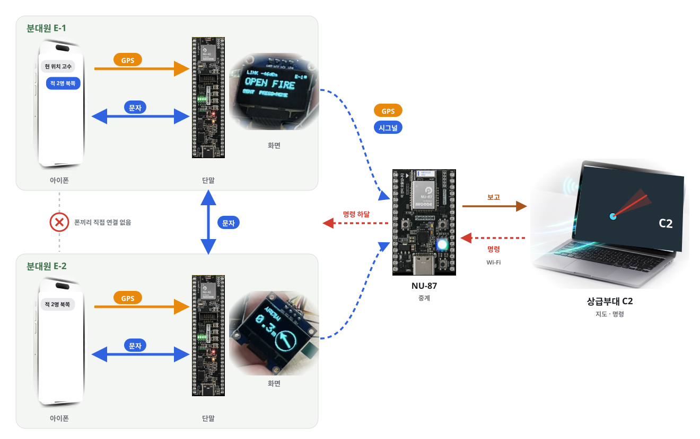
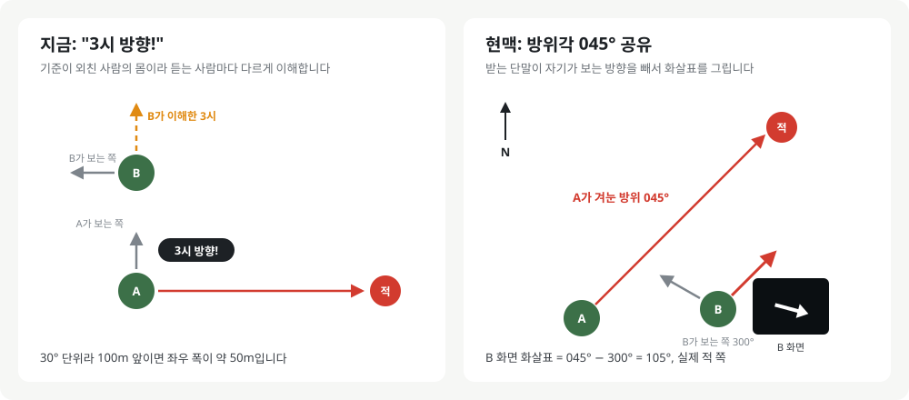
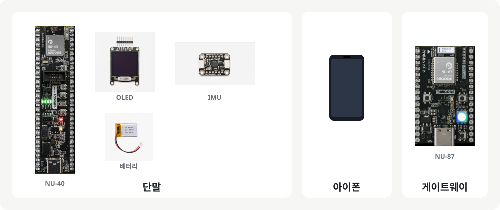

# 현맥 · 단말 펌웨어

**"3시 방향!" 대신, 정확한 적 방향을.**

현맥은 분대원이 손목에 차는 전술 단말입니다.  
적을 겨누고 버튼을 누르면 분대원 모두의 화면에 적 방향 화살표가 뜨고, 몸을 돌려도 화살표는 계속 적을 가리킵니다.  
단말끼리는 암호화된 블루투스 방송으로 소리 없이 연결됩니다.

[firmware](https://github.com/hyeonmaek/firmware) · [app](https://github.com/hyeonmaek/app) · [web](https://github.com/hyeonmaek/web)




## 🎯 정확한 적 방향

분대는 적 방향을 "3시 방향!"처럼 시계 구호로 외칩니다. 하지만 3시는 외친 사람의 몸이 기준이라 듣는 사람마다 가리키는 곳이 다르고, 30° 단위라 정확하지도 않습니다. 무엇보다 소리를 내야 합니다.

그래서 방향을 **진북 기준 방위각**으로 바꿔 보냅니다. 받는 단말은 자기가 보고 있는 방위를 빼서 화살표를 그립니다. 누가 어느 쪽을 보고 있든 화살표는 실제 적을 가리킵니다.



| 키워드 | 쓰임 |
|---|---|
| 6축 IMU 자이로 적분 | 단말이 향한 방위 측정 |
| 중력 벡터 투영 | 기울여 들어도 수평 회전만 계산 |
| 정지 감지 바이어스 보정 | 자이로 드리프트 제거 |
| 진북 영점 | S1 3초로 북쪽 기준 설정, 재부팅 후에도 유지 |

## 🔒 분대 통신

단말끼리는 연결 없이 BLE 광고로 1:N 방송합니다. 무전기보다 도달 거리가 짧아 탐지되기 어렵고, 몇 명이든 동시에 받습니다. 근거리 무선은 녹음과 위조가 쉬우므로 모든 방송을 암호화하고 인증합니다.

| 키워드 | 쓰임 |
|---|---|
| AES-128 CTR | 방송 내용 암호화 |
| CBC-MAC | 위조 방송 거부 |
| 단조 증가 카운터 | 재생 공격 거부, 플래시에 저장해 재부팅 후에도 유지 |
| BLE LESC Passkey | 폰 연결 시 6자리 번호 인증 |

암호 구현은 NIST FIPS-197 시험값으로 검증했습니다.

C2의 명령은 분대가 먼저 송신할 때(사격개시, 긴급구호, 메시지)만 함께 내려옵니다. 평소에는 단말이 반응하지 않게 하기 위해서입니다. 받은 메시지도 화면을 덮지 않고 알림만 띄웁니다.

## 🧩 구성



## 🕹 버튼


## 🛠 빌드

```sh
cp Tap_Talk/squad_key.h.example Tap_Talk/squad_key.h
cp NU87_Gateway/secrets.h.example NU87_Gateway/secrets.h
arduino-cli compile --fqbn nucode:nrf52:nu40dk Tap_Talk
```

한글 글꼴: Galmuri11 (SIL OFL 1.1)
