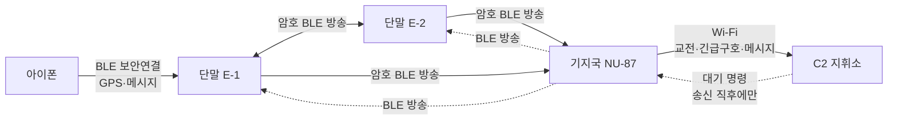

# 현맥 (玄脈) · 단말·기지국 펌웨어

**총을 놓지 않고, 전파를 숨긴 채, 분대 전체가 같은 적을 보고 같은 명령을 받는다.**

D4D × EDTH SEOUL 2026 출품작 · [firmware](https://github.com/hyeonmaek/firmware) · [app](https://github.com/hyeonmaek/app) · [web](https://github.com/hyeonmaek/web)

## 문제

| 현장의 문제 | 결과 |
|---|---|
| 적을 본 병사가 방향을 말로 설명해야 한다 | 소리가 나고, 느리고, 동료마다 다르게 이해한다 |
| 무전·데이터 송신은 그 자체로 위치를 드러낸다 | 통신할수록 탐지된다 |
| 근거리 무선은 녹음·위조가 쉽다 | 가짜 "적 발견"이나 옛 신호 재생으로 분대를 교란할 수 있다 |
| 지휘소 명령은 언제든 내려온다 | 은밀 행동 중 수신 장비가 반응한다 |

## 해법

| 문제 | 기술 | 구현 |
|---|---|---|
| 방향 공유 | **IMU 자이로 방위 + 방송** | 버튼 한 번에 내가 겨눈 방위를 분대에 방송. 동료 화면엔 적 방향 화살표와 거리가 뜨고, **동료가 몸을 돌리면 화살표가 따라 돈다** |
| 위조·재생 | **AES-128 CTR + CBC-MAC + 카운터** | 25바이트 암호 프레임을 BLE 광고 한 개(31바이트)에 담음. 태그 불일치는 위조로, 카운터 역행은 재생으로 버림 |
| 탐지 | **연결 없는 1:N 방송 + 송신 시에만 하달** | 지휘소 명령은 분대가 송신(교전·긴급구호·보고)하는 순간에만 기지국이 실어 보낸다 |
| 위치 | **폰 GPS를 단말이 보관** | 폰이 2초마다 단말에 좌표를 넣어 두고, 보고 순간 암호 프레임에 함께 실린다 |

## 구조



| 장치 | 하드웨어 | 역할 |
|---|---|---|
| 단말 `Tap_Talk/` | nRF52840 (NU-40 DK), LSM6DS3TR-C IMU, SSD1306 OLED | 방위 측정, 버튼 보고, 암호 방송 송수신, 한글 메시지 표시 |
| 기지국 `NU87_Gateway/` | Realtek AmebaD (NU-87) | 분대 방송 복호화, 지휘소 업로드, 명령 방송 |

## 핵심 기술

**1. 31바이트 안의 암호 통신** · `Tap_Talk/secure.h`
- 프레임 `[회사ID 2][버전][보낸이][카운터 3][암호문 14][태그 4]` = 25바이트
- 마스터키에서 암호용·인증용 키를 분리 파생. 카운터가 매 송신 증가해 키스트림을 재사용하지 않는다
- 카운터는 플래시에 1000 단위로 예약 저장 → **재부팅해도 뒤로 가지 않아** 동료·기지국이 정상 신호를 재생 공격으로 오인하지 않는다
- 맥에서 같은 코드를 **NIST FIPS-197 시험값**으로 검증 (`tools/crypto_test.c`)

**2. 나침반 없는 진북 방위** · `updateHeading()`
- 자이로 회전 속도를 **중력 방향 축**으로 투영해 적분 → 단말을 기울여 들어도 수평 회전만 잡는다
- 1초 창마다 정지 여부를 판정해 **자이로 치우침 자동 학습 + 정지 중 누적 오차 되돌림**
- S1 3초로 진북 기준 설정. 방위는 플래시에 저장돼 **재부팅·펌웨어 갱신 후에도 유지**
- 센서 리셋·접촉 불량은 2초마다 감지해 자동 재설정

**3. 방송으로 보내는 한글 메시지**
- UTF-16 11글자씩 조각내 최대 66글자를 광고로 순환 방송. 수신 측은 조각 비트마스크로 재조립, (보낸이, 번호)로 중복 제거
- 번호 체계로 발신 구분: 지휘소(1~127) / 분대원(128~) / 지휘소행(+0x40, 동료는 무시하고 기지국만 수신)
- KS X 1001 완성형 2,350자 픽셀 글꼴(Galmuri11)을 펌웨어에 내장, 띄어쓰기 단위 줄바꿈

**4. 폰 연결 보안**
- BLE LESC 페어링 + MITM 방지: 단말 화면의 6자리 번호를 폰에 입력해야 연결
- 본딩을 끄고 매 연결마다 번호 요구. 틀리면 단말·앱 양쪽에 실패 표시

**5. 혼잡한 전파 환경의 기지국**
- 행사장의 초당 수백 개 광고 중 원본 바이트에서 우리 표식만 골라 복호화(전체 파싱 생략)
- Wi-Fi와 안테나를 공유하므로 BLE 스캔을 30%로 제한해 응답 지연 방지
- 켜질 때 이미 방송 중이던 지난 사건은 올리지 않는다(재부팅 시 가짜 보고 방지)

## 단말 조작

| 버튼 | 동작 |
|---|---|
| S1 | 시계 화면으로 · 3초 = 진북 기준 설정 |
| S2 | 받은 메시지 보기 (보낸이·도착 시각 표시) |
| S3 | 긴급구호 · 3초 안에 한 번 더 = 취소 |
| S4 | 1번 사격개시 · 2번 사격금지 · 3번 취소 (3초 안) |

3초가 지나면 자동 전송되고, 이후 같은 버튼은 시계 화면으로 돌아간다.

## 검증

| 항목 | 방법 | 결과 |
|---|---|---|
| AES-128 정확성 | NIST FIPS-197 시험값 | 일치 |
| 위조 거부 | 열쇠 없이 만든 방송 송출 (시리얼 `z`) | 수신 단말 "공격감지" 표시, 내용 무시 |
| 재생 거부 | 녹음한 방송 5초 뒤 재송출 (시리얼 `x`) | 재생으로 판정해 버림 |
| 재부팅 후 연결 | 단말 재부팅 | 1초 안에 동료·기지국 재연결 |
| 하달 조건 | 지휘소 명령 후 단말 긴급구호 | 송신 2초 뒤 해당 단말 수신 |

## 빌드

```sh
cp Tap_Talk/squad_key.h.example Tap_Talk/squad_key.h       # 분대 공용 열쇠 (git 제외)
cp NU87_Gateway/secrets.h.example NU87_Gateway/secrets.h   # Wi-Fi (git 제외)
arduino-cli compile --fqbn nucode:nrf52:nu40dk Tap_Talk && tools/upload_nu40.sh <USB 일련번호>
tools/upload_nu87.sh NU87_Gateway
```

글꼴: Galmuri11 (SIL OFL 1.1, `docs/licenses/`)
